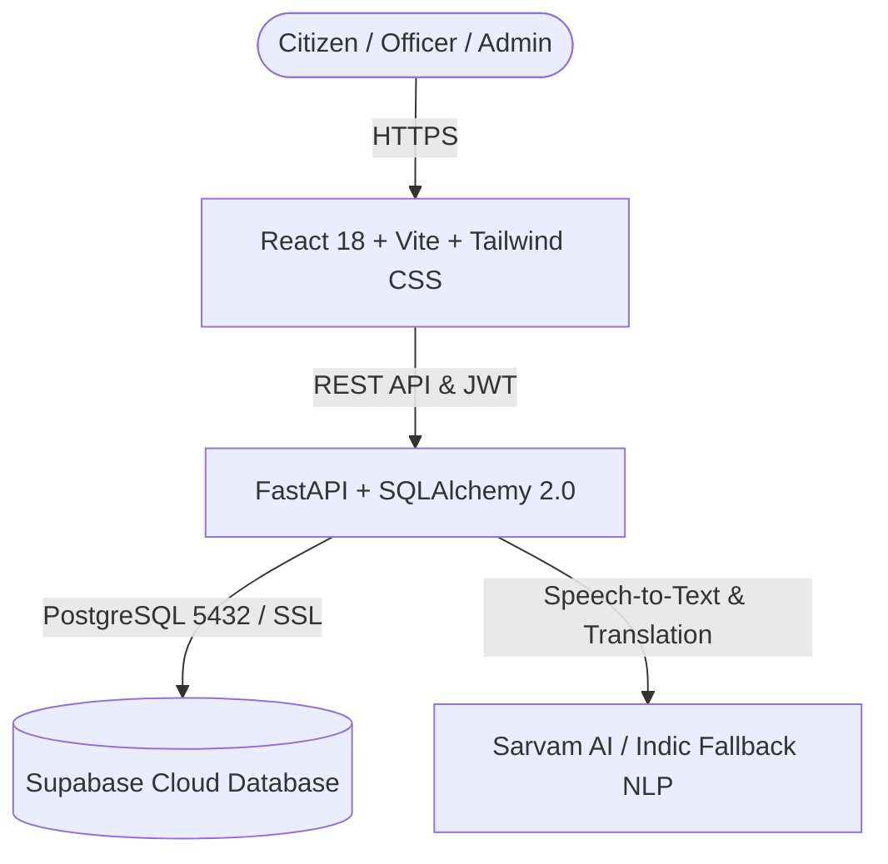

# 🏛️ JanSahayak AI (Team Neural-Storm)
### *AI-Powered Multilingual Public Grievance Redressal Platform*
> **"Your Language. Your Voice. Your Government."**

[](https://fastapi.tiangolo.com)
[](https://react.dev/)
[](https://www.typescriptlang.org/)
[](https://supabase.com)
[](https://tailwindcss.com/)

---

## 📌 Overview

**JanSahayak AI** bridges the communication divide between citizens and public administration across India. Citizens can report grievances in their native tongue using spoken audio or text. The system automatically transcribes, translates, assesses urgency, assigns tickets to the appropriate government department with strict SLA tracking, and keeps citizens updated in real time without disclosing private information.

---

## ✨ Key Features

1. **🎙️ Multilingual Indic Voice & Speech Studio**:
   - Live microphone capture with Web Audio API equalizer volume meters.
   - Works across all browsers (including Brave, Chrome, Firefox, Edge).
   - Audio playback review and AI-powered speech-to-text transcription.

2. **🤖 Multi-Topic AI Grievance Routing**:
   - Automatic classification across **11 distinct Government Departments**:
     - *Department of Water Supply & Sewerage*
     - *Department of Energy & Power*
     - *Public Works Department (PWD)*
     - *Municipal Corporation & Sanitation*
     - *Department of Health & Family Welfare*
     - *Department of Transport*
     - *Department of School Education*
     - *Food & Civil Supplies Department (PDS)*
     - *Department of Police & Public Safety*
     - *Revenue & Land Administration*
     - *General Administration Department*
   - Urgency scoring with SLA deadline calculation (24h Critical, 48h High, 96h Medium, 168h Low).

3. **👥 4 Role-Based Administrative Portals**:
   - **Citizen**: File grievances, record audio, track tickets, submit feedback.
   - **Field Officer**: Update status, add progress notes, resolve tickets.
   - **Department Head**: Department SLA monitoring, overdue escalations.
   - **System Admin**: Cross-department analytics, audit logging, category mappings.

4. **🔍 Public Grievance Tracking**:
   - Citizens can track any ticket (e.g. `JSA-2026-XXXXXX`) publicly with a clean progress timeline that redacts all citizen PII and internal officer notes.

---

## 🛠️ Tech Stack & Architecture



- **Frontend**: Vite 5, React 18, TypeScript, Tailwind CSS, Lucide Icons.
- **Backend**: FastAPI, SQLAlchemy 2.0, Uvicorn, Pydantic v2.
- **Database**: Supabase PostgreSQL (15 relational tables with automated migration & seeding).

---

## 🚀 Quickstart for Collaborators

### Prerequisites
- Node.js 18+ & npm
- Python 3.10+
- Git

### 1. Clone the Repository
```bash
git clone https://github.com/Anushka-Nirmal/Neural-Storm.git
cd Neural-Storm
```

### 2. Configure Environment Variables
Copy `.env.example` into both root and backend directories:
```bash
cp .env.example .env
cp backend/.env.example backend/.env
```
*(Contact project leads for the team Supabase credentials or configure your own database)*.

### 3. Backend Setup
```bash
cd backend
python -m venv venv
# On Windows:
.\venv\Scripts\activate
# On macOS/Linux:
source venv/bin/activate

pip install -r requirements.txt
uvicorn app.main:app --reload --host 127.0.0.1 --port 8000
```
- API Health: `http://127.0.0.1:8000/health`
- Interactive Swagger Docs: `http://127.0.0.1:8000/docs`

### 4. Frontend Setup
In a new terminal:
```bash
cd frontend
npm install
npm run dev
```
Open **`http://localhost:5173`** in your browser.

---

## 🔑 Pre-Configured Demo Accounts

| Role | Email | Password | Access Level |
| :--- | :--- | :--- | :--- |
| **Citizen** | `citizen@jansahayak.gov.in` | `CitizenPassword@2026` | Submit grievances, voice studio, track tickets |
| **Field Officer** | `officer.water@jansahayak.gov.in` | `StaffPassword@2026` | Department ticket workspace, status updates |
| **Department Head** | `head.water@jansahayak.gov.in` | `StaffPassword@2026` | SLA escalation panel, department metrics |
| **System Admin** | `admin@jansahayak.gov.in` | `AdminPassword@2026` | Platform analytics, category mappings, audit logs |

---

## 🧪 Testing

Run backend test suite:
```bash
pytest backend/tests -v
```

Run frontend production build verification:
```bash
cd frontend
npm run build
```

---

## 📄 License
This project is developed for public benefit and civic innovation.
